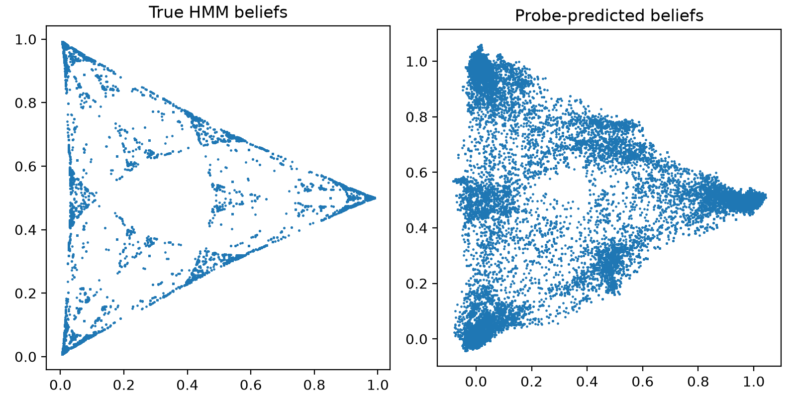

# Belief-State Geometry in Transformers

This repository is a ground-up implementation and study of [*Transformers Represent Belief State Geometry in Their Residual Stream*](https://arxiv.org/abs/2405.15943) by Adam S. Shai et al.

The reference and more terminal-ready implementation is [danibalcells' `belief-state-transformers` repository](https://github.com/danibalcells/belief-state-transformers).

My goal was initially to reproduce the core belief-state geometry experiment from the ground up, understand each component in detail, and then extend the setup by modifying the HMM observation dynamics while controlling the underlying latent transition process.

The original replication worked:



The left panel shows the exact Bayesian posterior geometry calculated from the known HMM. The right panel shows the corresponding geometry decoded from the transformer's residual stream using a linear probe.

The transformer is trained only for next-token prediction. It is never given the hidden state, the transition matrix, or the Bayesian posterior directly.

That result led to the main question behind the extension.

> **If the hidden-state dynamics stay the same, but the observations become more or less informative, does the transformer's internal belief representation change with the inference problem?**

---

## From replication to intervention

Mess3 is a partially observable process with three hidden states and three observable symbols.

The hidden-state dynamics are governed by a transition matrix

`T_ij = P(H_{t+1} = j | H_t = i)`

which is kept fixed throughout the extension.

What I change is only the observation channel.

The original observation model is gradually interpolated toward a completely uninformative one:

```math
E_{\lambda}=(1-\lambda)E_0+\lambda U
```

where:

- `λ = 0` recovers the original Mess3 observation channel,
- increasing `λ` makes the observations less informative,
- `λ = 1` makes the observations independent of the hidden state.

So the hidden process itself does not change.

What changes is how much an observer can infer about that hidden process from the emitted observations.

This gives a controlled intervention on **observability**.

---

## What is being represented?

The HMM is always in one actual hidden state.

But the transformer never sees that hidden state directly. It only sees the observation sequence.

An ideal Bayesian observer therefore maintains a posterior belief over the possible hidden states:

```math
b_t(i)=P(H_t=i\mid X_{1:t-1})
```

This belief is not the hidden state itself.

It represents uncertainty about the hidden state given everything observed so far.

For a three-state HMM, each posterior is a three-dimensional probability vector whose entries sum to one, so all possible beliefs lie on a two-dimensional simplex.

Over many observation histories, these posteriors form a characteristic geometry.

Because the HMM is known to us, the exact Bayesian posterior can be calculated directly.

The transformer, however, is never trained to reproduce this posterior.

It is trained only to predict the next token.

After training, I extract the final-layer residual activations and train a linear probe

```math
\hat b_t=Wh_t+c
```

to decode the Bayesian posterior from the transformer's internal state.

So the two sides of each comparison plot mean:

- **left:** the exact Bayesian posterior calculated directly from the HMM,
- **right:** the posterior decoded from the transformer's residual stream using a linear probe.

The interesting part is that the transformer was never explicitly told to construct the object shown on the left.

---

## Changing observability

The amount of information that an observation contains about the hidden state can be summarized using mutual information:

```math
I(H;X)
=
\sum_{h,x}
P(h,x)
\log
\frac{P(h,x)}
{P(h)P(x)}
```

For the interpolation used here:

| λ | I(H;X) in nats |
|---:|---:|
| 0.00 | 0.572 |
| 0.25 | 0.313 |
| 0.50 | 0.139 |
| 0.75 | 0.036 |
| 1.00 | 0 |

The latent transition matrix remains unchanged across these conditions.

Only the information available through the observations changes.

This turns out to change the exact Bayesian belief geometry substantially.

A fresh transformer is trained from scratch for each observation condition, using the same architecture and next-token prediction objective.

For each condition, I then ask whether the altered Bayesian belief geometry is still linearly accessible from the residual stream.

So far, the answer appears to be yes.

At `λ = 0.25`, the exact posterior geometry becomes much denser than the original Mess3 geometry, and the probe-decoded transformer representation follows that change closely.

At `λ = 0.75`, the observations are only weakly informative, the reachable posterior geometry contracts strongly, and the corresponding transformer representation again follows the altered belief geometry.

The detailed intervention write-up is here:

[Observability intervention](observability_intervention.md)

---

## Does the internal representation itself change?

There is another question hiding inside the result.

For `λ = 0.25`, a probe trained on the `λ = 0.25` transformer successfully decodes the corresponding Bayesian beliefs.

For `λ = 0.75`, a separately trained probe also works.

But if the probe trained at `λ = 0.25` is applied directly to the residual activations of the `λ = 0.75` transformer, the decoded geometry becomes strongly distorted.

So:

```math
W_{0.25} h_t^{0.25} \approx b_t^{0.25}
```

and

```math
W_{0.75} h_t^{0.75} \approx b_t^{0.75}
```

but

```math
W_{0.25} h_t^{0.75} \not\approx b_t^{0.75}
```

This suggests that changing observability may do more than change which belief states are visited.

The way belief information is organized inside the residual stream may itself change.

That result is still preliminary, but it raises a simple question:

> **Does changing observability only change what the model believes, or does it also change how those beliefs are represented internally?**

---

## What I think the extension is asking

The original experiment asks whether a transformer trained for prediction can develop representations related to Bayesian belief states.

This extension asks what shapes those representations.

The hidden world is kept the same.

What changes is the relationship between that hidden world and the evidence available to the model.

That changes what an ideal observer should believe after seeing a particular history.

The transformer appears to follow those changes.

A useful picture is:

```text
observation history
        ↓
internal predictive state
        ↓
next-token prediction
```

For this HMM, the Bayesian posterior is a compact summary of the history that contains the information needed for optimal prediction.

The transformer is never explicitly trained to construct that posterior.

Nevertheless, next-token training produces an internal state from which it can be linearly recovered.

The current results therefore suggest that the learned representation is shaped not only by the latent process itself, but also by the uncertainty induced by partial observability.

I do not interpret this as evidence that the transformer has an explicit concept of "observability".

A more careful interpretation is:

> **The transformer's predictive representation adapts to how informative the observations are about the underlying latent state.**

That leaves a deeper question open:

> **Is the model representing the hidden world itself, the information it can infer about that world, or some combination of the two?**

---

## Visual summary

<table>
  <tr>
    <td align="center">
      <br>
      <sub><b>Original Mess3</b></sub>
    </td>
    <td align="center">
      <br>
      <sub><b>λ = 0.25</b></sub>
    </td>
    <td align="center">
      <br>
      <sub><b>λ = 0.75</b></sub>
    </td>
  </tr>
</table>

The latent transition matrix is the same in all three conditions.

What changes is the informativeness of the observation channel.

The exact Bayesian geometry changes with that intervention, and the linearly decoded transformer representation changes with it.

---

## Current next steps

The current results are still preliminary.

The next useful tests are:

- repeat the transformer and probe training across multiple random seeds,
- quantify the geometric changes instead of relying only on visual comparison,
- complete the cross-probe comparisons in both directions,
- compare observation channels with similar mutual information but different state-confusion structures.

The last experiment is especially interesting because it asks whether the representation depends mainly on **how much information is available**, or on **which distinctions about the hidden world are preserved by the observations**.

## References

- Adam S. Shai et al., [*Transformers Represent Belief State Geometry in Their Residual Stream*](https://arxiv.org/abs/2405.15943), NeurIPS 2024.
- Dani Balcells, [`belief-state-transformers`](https://github.com/danibalcells/belief-state-transformers).
